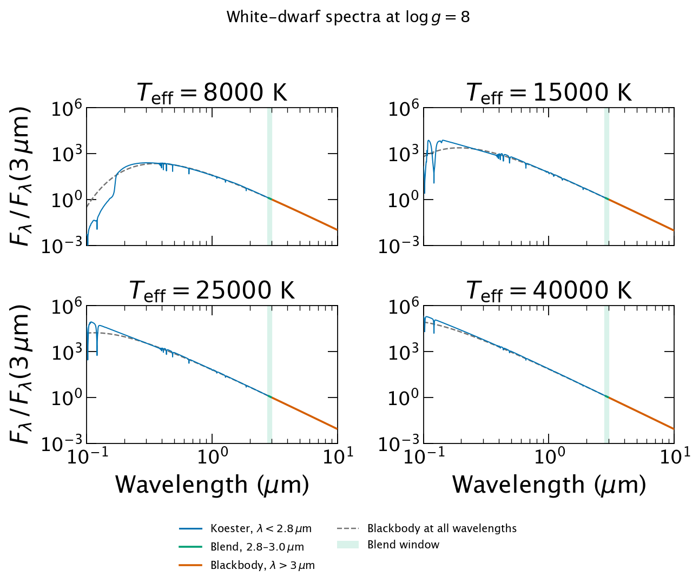
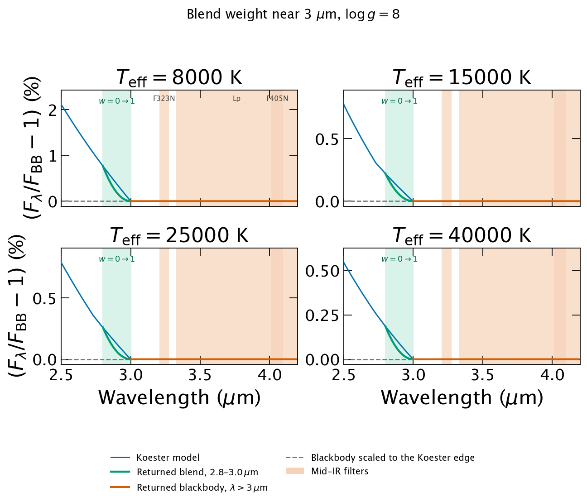

.. _atmo_models:

========================================
Atmosphere Model Object
========================================
Stellar atmosphere models are defined as functions in
``spisea/atmospheres.py``. These can be called by::

 from spisea import atmospheres
 atmo = atmospheres.<function_name>

To call an atmosphere for a particular star, user must define the
metallicity ([Z]), temperature (in K), and gravity (in cgs)::

  spectrum = atmo(metallicity=0, temperature=5800, gravity=4)
  from astropy import units
  wave = spectrum.waveset.to(units.AA).value   # Wavelength in Angstroms
  flux = spectrum(spectrum.waveset)  # Flux (synphot Quantity; typically FLAM)

The atmosphere function is an input for the :ref:`isochrone_objects`,
and will automatically be used to define the
spectrum of each star in the isochrone model.

SPISEA uses the stsynphot/synphot stack to extract the model atmosphere,
and the output spectrum is a synphot ``SourceSpectrum`` built from the CDBS grid via ``stsynphot.grid_to_spec``.

Below is a table of atmosphere model grids currently supported by
SPISEA. Note that the resolution column reports the original
resolution of the atmosphere model grid. These are available in the
`spisea_cdbs_highres.tar.gz` file on the installation page. However, the default grid SPISEA
uses has degraded the resolution of all atmosphere grids to R = 250
(the `spisea_cdbs.tar.gz` file). 

.. list-table:: Atmosphere Models
   :header-rows: 2
   :widths: 25 15 12 15 12 18 20
 
   * - Model Name
     - T\ :sub:`eff` Range (K)
     - log *g* Range (cgs)
     - Metallicity Range [Fe/H]
     - λ Range (μm)
     - Resolution\ :sup:`a` λ/Δλ
     - Ref
   * - ``get_merged_atmosphere``
     - 250 – 50000
     - \ :sup:`b`
     - \ :sup:`b`
     - \ :sup:`b`
     - \ :sup:`b`
     - Appendix B; Hosek et al. (2020)
   * - ``get_castelli_atmosphere``
     - 3500 – 50000
     - 0 – 5.0
     - -2.5 – 0.2
     - 0.1 – 10
     - ~250
     - Castelli & Kurucz (2004)
   * - ``get_phoenixv16_atmosphere``
     - 2300 – 12000
     - 0.0 – 6.0
     - -4.0 – +1.0
     - 0.05 – 5.5
     - 100,000 – 500,000
     - Husser et al. (2013)
   * - ``get_BTSettl_2015_atmosphere``
     - 1200 – 7000
     - 2.5 – 5.5
     - 0
     - 0.01 – 30
     - 2000 – 700,000
     - Baraffe et al. (2015)
   * - ``get_BTSettl_atmosphere``\ :sup:`d`
     - 2600 – 7000
     - 4.5 – 5.5
     - -2.5 – 0.5
     - 0.1 – 6.9
     - 20,000 – 250,000
     - Allard et al. (2012b,a)
   * - ``get_kurucz_atmosphere``
     - 3000 – 50000
     - 0 – 5.0
     - -5.0 – 1.0
     - 0.1 – 10
     - ~250
     - \ :sup:`c`
   * - ``get_phoenix_atmosphere``
     - 2100 – 69000
     -
     - -4.0 – 0.5
     - 0.001 – 995
     - ~280
     - Allard et al. (2003, 2007)
   * - ``get_Phillips2020_atmosphere``
     - 200 - 3000
     - 2.5 - 5.5
     - 0
     - 0.2 - ~1980.2
     - 0.5 - 5000
     - Phillips et al. (2020)
   * - ``get_Meisner2023_atmosphere``
     - 250 - 1200
     - 2.5 - 5.5
     - -1.0 - 0.3
     - 0.2 - 30
     - ~3000
     - Meisner et al. (2023)
   * - ``get_wd_atmosphere``\ :sup:`e`
     - –
     - –
     - –
     - 0.09 – 10\ :sup:`f`
     - 200 – 500,000
     - Koester (2010)
   * - ``get_bb_atmosphere``
     - –
     - –
     - –
     - –
     - –
     - Blackbody Spectrum
 
.. rubric:: Footnotes
 
:sup:`a` Resolution column reports the original resolution of the atmosphere model grid.
The default SPISEA grid degrades all atmosphere grids to R = 250 (``spisea_cdbs.tar.gz``).
 
:sup:`b` See Appendix B; values depend on the underlying model selected by ``get_merged_atmosphere``.
 
:sup:`c` Kurucz (1993); see CDBS documentation.
 
:sup:`d` Solar metallicity only for BTSettl 2015.
 
:sup:`e` White dwarf atmospheres only.

:sup:`f` Koester (2010) models end near 3 μm.
``get_wd_atmosphere`` blends the model with a blackbody from 2.8 to
3.0 μm and continues that blackbody to 10 μm.
See :ref:`wd_spectra`.

.. _wd_spectra:

White-dwarf spectra
-------------------
``get_wd_atmosphere`` returns a Koester (2010) atmosphere when the
requested temperature and surface gravity are on that grid. Those
models end near 3 μm. Mid-infrared filters such as JWST F323N and
F405N, NIRC2 Lp and Ms, and NSFCam L lie redward of the grid, so
``extend_spectrum_blackbody`` extends the spectrum with a blackbody
at the same effective temperature.

The blackbody is scaled to the Koester flux at the red edge of the
model. From 2.8 to 3.0 μm the returned flux is the weighted average

.. math::

   F_\lambda = (1 - w)\,F_{\mathrm{Koester}} + w\,F_{\mathrm{BB}},

where :math:`w` is linear in wavelength, with :math:`w = 0` at 2.8 μm
and :math:`w = 1` at 3.0 μm. Blueward of 2.8 μm the spectrum is the
Koester model. Redward of 3 μm it is the blackbody alone, out to
10 μm. Near 3 μm the Koester continuum is already within about 1% of
that blackbody, so the blend changes the flux by a fraction of a
percent. The second figure shows that residual.

Temperatures or gravities outside the Koester grid return a blackbody
from 0.05 to 10 μm, with no model segment to blend.

The examples below use log g = 8 and solar metallicity.

   White-dwarf spectra at four effective temperatures.
   Flux is normalized at 3 μm. The narrow band near 3 μm is the
   2.8–3.0 μm blend. The orange curve is the blackbody tail returned
   by ``get_wd_atmosphere``. The dashed curve is that same blackbody
   drawn at all wavelengths.

   Same models, as the percent difference from the blackbody scaled
   to the Koester red edge. In the 2.8–3.0 μm window the returned
   spectrum (green) moves from the Koester model to the blackbody.
   Redward of 3 μm, including JWST F323N and F405N and NIRC2 Lp, the
   spectrum is the blackbody.

Regenerate the figures from the repository root with::

   python docs/figures/plot_wd_koester_blackbody.py

Model Atmosphere Classes
-------------------------
.. autofunction:: atmospheres.get_merged_atmosphere

.. autofunction:: atmospheres.get_wd_atmosphere

.. autofunction:: atmospheres.extend_spectrum_blackbody

.. autofunction:: atmospheres.get_bb_atmosphere
   
.. autofunction:: atmospheres.get_castelli_atmosphere

.. autofunction:: atmospheres.get_phoenixv16_atmosphere
		  
.. autofunction:: atmospheres.get_BTSettl_2015_atmosphere
		  
.. autofunction:: atmospheres.get_BTSettl_atmosphere
		 
.. autofunction:: atmospheres.get_wdKoester_atmosphere

.. autofunction:: atmospheres.get_kurucz_atmosphere

.. autofunction:: atmospheres.get_phoenix_atmosphere

.. autofunction:: atmospheres.get_Phillips2020_atmosphere

.. autofunction:: atmospheres.get_Meisner2023_atmosphere

