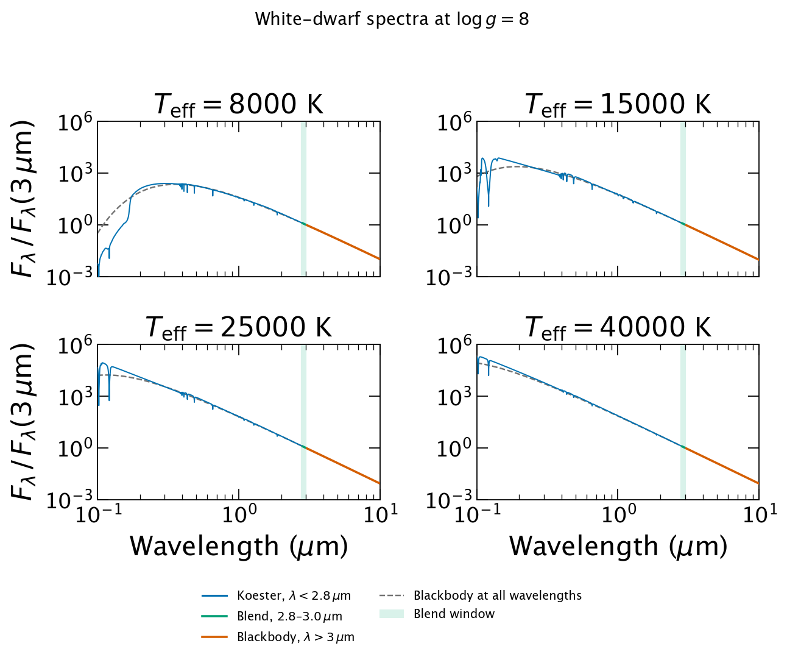
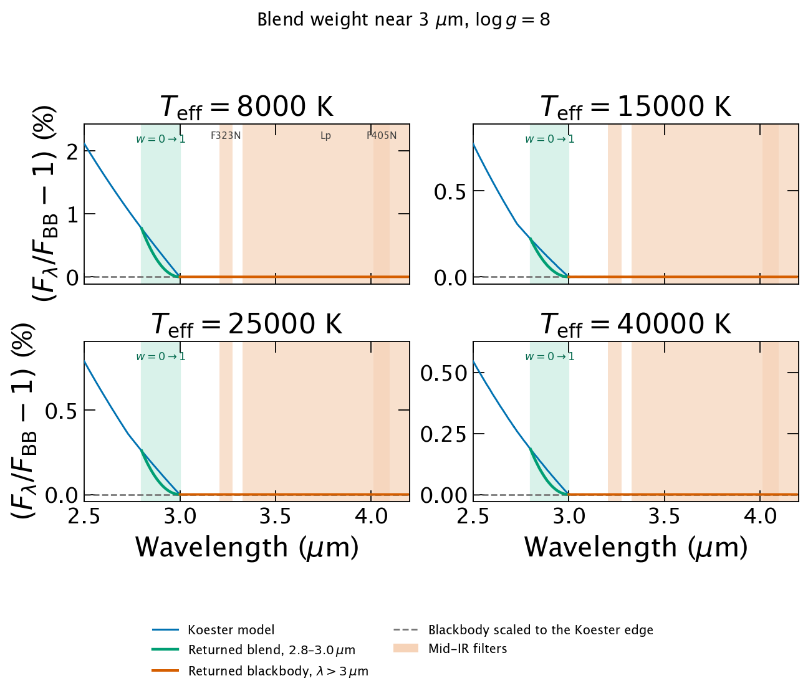

.. _atmo_models:

========================================
Atmosphere Model Object
========================================

**Preferred for new work:**
``get_merged_atmosphere_v3``
(ATLAS / PHOENIX / Sonora FlameSkimmer).
Use ``get_merged_atmosphere_v3bb`` when you need white-dwarf or
blackbody coverage for high-gravity objects (including filters
beyond 3 μm). Pair with
``evolution.MergedFlameSkimmerRedDiamondbackMIST``.

``IsochronePhot`` still defaults to ``get_merged_atmosphere_v1``
(legacy Hosek et al. 2020 merge) if you do not pass ``atm_func``.
``get_merged_atmosphere`` remains as an alias of v1.

Stellar atmosphere models are defined as functions in
``spisea/atmospheres.py``. These can be called by::

 from spisea import atmospheres
 atmo = atmospheres.get_merged_atmosphere_v3

To call an atmosphere for a particular star, user must define the
metallicity ([Z]), temperature (in K), and gravity (in cgs)::

  spectrum = atmo(metallicity=0, temperature=5800, gravity=4)
  from astropy import units
  wave = spectrum.waveset.to(units.AA).value   # Wavelength in Angstroms
  flux = spectrum(spectrum.waveset)  # Flux (synphot Quantity; typically FLAM)

The atmosphere function is an input for the :ref:`isochrone_objects`,
and will automatically be used to define the
spectrum of each star in the isochrone model.

SPISEA uses the stsynphot/synphot stack to extract the model atmosphere,
and the output spectrum is a synphot ``SourceSpectrum`` built from the CDBS grid via ``stsynphot.grid_to_spec``.

Which archive provides each atmosphere grid
-------------------------------------------
SPISEA atmospheres live under ``$PYSYN_CDBS/grid/`` as CDBS-style
catalogs. Different archives supply different catalogs. For a standard
SPISEA 3.1 install you need **both** STScI Reference Atlases pieces
**and** ``spisea_cdbs.tar.gz`` (see :ref:`set-up-cdbs` and
:ref:`models`). Details and sizes are on the `SPISEA Data Downloads
<https://w.astro.berkeley.edu/~jlu/spisea/index.html>`_ page.

.. list-table:: Atmosphere grids by download archive
   :header-rows: 1
   :widths: 28 36 36

   * - Archive
     - Provides (``cdbs/grid/`` catalogs)
     - Used by
   * - STScI ``synphot1_throughput-master.tar``
     - Filter throughputs only (``comp/``, ``mtab/``); **no** atmosphere grids
     - All synthetic photometry
   * - STScI ``synphot5_pheonix-models.tar``
     - ``phoenix`` (and related STScI Phoenix products)
     - ``get_phoenix_atmosphere``; components of some merges
   * - SPISEA ``spisea_cdbs.tar.gz`` (R = 250; **required**)
     - ``ck04models``, ``k93models``, ``phoenix_v16_rebin``,
       ``BTSettl_rebin``, ``BTSettl_2015_rebin``,
       ``FlameSkimmer_rebin``, ``Meisner2023_rebin``,
       ``Phillips2020_rebin``, ``wdKoester`` / ``wdKoester_rebin``,
       ``merged_atlas_phoenix``, ``merged_BTSettl_phoenix``,
       ``merged_BTSettl_meisner``, ``merged_flameskimmer_phoenix``
     - Preferred merges
       (``get_merged_atmosphere_v3`` / ``v3bb`` / ``v1`` / ``v1bb``),
       Castelli/Kurucz, PHOENIXv16, BT-Settl, FlameSkimmer,
       Meisner2023, Phillips2020, Koester WD, and the tabulated merges
   * - SPISEA ``spisea_cdbs_highres.tar.gz`` (**optional**)
     - Higher-resolution versions of the SPISEA atmosphere catalogs
     - Same functions as ``spisea_cdbs.tar.gz`` when ``rebin=False``
       / high-res paths are selected; not needed for default R = 250
       photometry
   * - None (computed)
     - —
     - ``get_bb_atmosphere`` (blackbody; no catalog file)

**Not included** in the STScI + SPISEA archives above (and not part of
a standard install): ``nextgen``, ``AMESdusty``, and the CMFGEN grids
(``cmfgen_rot``, ``cmfgen_norot``, ``cmfgenF15_noRot``, …). Calling
``get_nextgen_atmosphere``, ``get_amesdusty_atmosphere``, or the
``get_cmfgen*_atmosphere`` helpers will fail with a missing
``catalog.fits`` unless you add those catalogs yourself under
``$PYSYN_CDBS/grid/``. See GitHub issue #170.

Below is a table of atmosphere model grids currently supported by
SPISEA. Note that the resolution column reports the original
resolution of the atmosphere model grid. High-resolution copies of the
SPISEA-packaged grids are in `spisea_cdbs_highres.tar.gz
<https://w.astro.berkeley.edu/~jlu/spisea/spisea_cdbs_highres.tar.gz>`_.
The default grid SPISEA uses has degraded those SPISEA atmospheres to
R = 250 (`spisea_cdbs.tar.gz
<https://w.astro.berkeley.edu/~jlu/spisea/spisea_cdbs.tar.gz>`_).
See :ref:`models` for where to unpack them. 

.. list-table:: Atmosphere Models
   :header-rows: 2
   :widths: 25 15 12 15 12 18 20
 
   * - Model Name
     - T\ :sub:`eff` Range (K)
     - log *g* Range (cgs)
     - Metallicity Range [Fe/H]
     - λ Range (μm)
     - Resolution\ :sup:`a` λ/Δλ
     - Ref
   * - ``get_merged_atmosphere_v3``\ :sup:`g`
     - 250 – 50000
     - \ :sup:`b`
     - \ :sup:`b`
     - \ :sup:`b`
     - \ :sup:`b`
     - ATLAS/PHOENIX/FlameSkimmer; Begbie et al. (2026)
   * - ``get_merged_atmosphere_v3bb``
     - 250 – 50000
     - \ :sup:`b`
     - \ :sup:`b`
     - \ :sup:`b`
     - \ :sup:`b`
     - v3 + WD/BB for high log *g*
   * - ``get_merged_atmosphere_v1``
     - 250 – 50000
     - \ :sup:`b`
     - \ :sup:`b`
     - \ :sup:`b`
     - \ :sup:`b`
     - Appendix B; Hosek et al. (2020)
   * - ``get_merged_atmosphere_v1bb``
     - 250 – 50000
     - \ :sup:`b`
     - \ :sup:`b`
     - \ :sup:`b`
     - \ :sup:`b`
     - v1 + WD/BB for high log *g*
   * - ``get_flameskimmer_atmosphere``
     - ~200 – 2400
     - ≥ 2
     - -1.0 – +0.5
     - \ :sup:`b`
     - \ :sup:`b`
     - Sonora FlameSkimmer (C/O = 1)
   * - ``get_castelli_atmosphere``
     - 3500 – 50000
     - 0 – 5.0
     - -2.5 – 0.2
     - 0.1 – 10
     - ~250
     - Castelli & Kurucz (2004)
   * - ``get_phoenixv16_atmosphere``
     - 2300 – 12000
     - 0.0 – 6.0
     - -4.0 – +1.0
     - 0.05 – 5.5
     - 100,000 – 500,000
     - Husser et al. (2013)
   * - ``get_BTSettl_2015_atmosphere``
     - 1200 – 7000
     - 2.5 – 5.5
     - 0
     - 0.01 – 30
     - 2000 – 700,000
     - Baraffe et al. (2015)
   * - ``get_BTSettl_atmosphere``\ :sup:`d`
     - 2600 – 7000
     - 4.5 – 5.5
     - -2.5 – 0.5
     - 0.1 – 6.9
     - 20,000 – 250,000
     - Allard et al. (2012b,a)
   * - ``get_kurucz_atmosphere``
     - 3000 – 50000
     - 0 – 5.0
     - -5.0 – 1.0
     - 0.1 – 10
     - ~250
     - \ :sup:`c`
   * - ``get_phoenix_atmosphere``
     - 2100 – 69000
     -
     - -4.0 – 0.5
     - 0.001 – 995
     - ~280
     - Allard et al. (2003, 2007)
   * - ``get_Phillips2020_atmosphere``
     - 200 - 3000
     - 2.5 - 5.5
     - 0
     - 0.2 - ~1980.2
     - 0.5 - 5000
     - Phillips et al. (2020)
   * - ``get_Meisner2023_atmosphere``
     - 250 - 1200
     - 2.5 - 5.5
     - -1.0 - 0.3
     - 0.2 - 30
     - ~3000
     - Meisner et al. (2023)
   * - ``get_wd_atmosphere``\ :sup:`e`
     - –
     - –
     - –
     - 0.09 – 10\ :sup:`f`
     - 200 – 500,000
     - Koester (2010)
   * - ``get_bb_atmosphere``
     - –
     - –
     - –
     - –
     - –
     - Blackbody Spectrum
 
.. rubric:: Footnotes
 
:sup:`a` Resolution column reports the original resolution of the atmosphere model grid.
The default SPISEA grid degrades all atmosphere grids to R = 250 (``spisea_cdbs.tar.gz``).
 
:sup:`b` See Appendix B; values depend on the underlying model selected by ``get_merged_atmosphere_v1``.
 
:sup:`c` Kurucz (1993); see CDBS documentation.
 
:sup:`d` Solar metallicity only for BTSettl 2015.
 
:sup:`e` White dwarf atmospheres only.

:sup:`f` Koester (2010) models end near 3 μm.
``get_wd_atmosphere`` blends the model with a blackbody from 2.8 to
3.0 μm and continues that blackbody to 10 μm.
See :ref:`wd_spectra`.

:sup:`g` Preferred atmosphere function for SPISEA 3.1.
``get_merged_atmosphere`` is kept as an alias of
``get_merged_atmosphere_v1``.

.. _wd_spectra:

White-dwarf spectra
-------------------
``get_wd_atmosphere`` returns a Koester (2010) atmosphere when the
requested temperature and surface gravity are on that grid. Those
models end near 3 μm. Mid-infrared filters such as JWST F323N and
F405N, NIRC2 Lp and Ms, and NSFCam L lie redward of the grid, so
``extend_spectrum_blackbody`` extends the spectrum with a blackbody
at the same effective temperature.

The blackbody is scaled to the Koester flux at the red edge of the
model. From 2.8 to 3.0 μm the returned flux is the weighted average

.. math::

   F_\lambda = (1 - w)\,F_{\mathrm{Koester}} + w\,F_{\mathrm{BB}},

where :math:`w` is linear in wavelength, with :math:`w = 0` at 2.8 μm
and :math:`w = 1` at 3.0 μm. Blueward of 2.8 μm the spectrum is the
Koester model. Redward of 3 μm it is the blackbody alone, out to
10 μm. Near 3 μm the Koester continuum is already within about 1% of
that blackbody, so the blend changes the flux by a fraction of a
percent. The second figure shows that residual.

Temperatures or gravities outside the Koester grid return a blackbody
from 0.05 to 10 μm, with no model segment to blend.

The examples below use log g = 8 and solar metallicity.

   White-dwarf spectra at four effective temperatures.
   Flux is normalized at 3 μm. The narrow band near 3 μm is the
   2.8–3.0 μm blend. The orange curve is the blackbody tail returned
   by ``get_wd_atmosphere``. The dashed curve is that same blackbody
   drawn at all wavelengths.

   Same models, as the percent difference from the blackbody scaled
   to the Koester red edge. In the 2.8–3.0 μm window the returned
   spectrum (green) moves from the Koester model to the blackbody.
   Redward of 3 μm, including JWST F323N and F405N and NIRC2 Lp, the
   spectrum is the blackbody.

Regenerate the figures from the repository root with::

   python docs/figures/plot_wd_koester_blackbody.py

Sonora, PHOENIX and ATLAS suite
-----------------------------------------
``get_merged_atmosphere_v3`` adds the C/O = 1 equilibrium
FlameSkimmer models to the stellar atmosphere models. Below 2500 K, stars
with log(g) >= 2 use FlameSkimmer through 2200 K and a FlameSkimmer/PHOENIX
blend from 2200 to 2500 K. Lower-gravity stars use PHOENIX. The log(g) limit
comes from the lowest gravity in FlameSkimmer.

Cool dwarfs below [M/H] = -1 use the -1 FlameSkimmer atmosphere and produce
a warning. At 2500-5000 K the function uses PHOENIX, at 5000-5500 K it uses
the ATLAS/PHOENIX blend, and above 5500 K it uses ATLAS. The separate
``get_merged_atmosphere_v3bb`` function adds
white-dwarf atmospheres and blackbodies for high-gravity objects.

Requests outside an atmosphere grid use ``get_atmosphere_bounds``, which
limits the temperature and gravity and chooses the nearest metallicity.
For PHOENIX, this raises temperatures below 2300 K to 2300 K. Interpolation
within the grid uses the requested metallicity.

The FlameSkimmer/PHOENIX blend has less blue flux where FlameSkimmer has
no wavelength coverage: only the weighted PHOENIX part contributes there.
The use of the -1 atmosphere at lower metallicities is also an approximation.

Model Atmosphere Classes
-------------------------
In SPISEA 3.1, ``get_merged_atmosphere`` was renamed
``get_merged_atmosphere_v1``. ``get_merged_atmosphere`` and
``get_merged_atmosphere_grid`` are kept and return
``get_merged_atmosphere_v1`` and ``get_merged_atmosphere_v1_grid``.
Isochrone files saved with ``get_merged_atmosphere`` are still read
without being regenerated.

.. autofunction:: atmospheres.get_merged_atmosphere_v1

.. autofunction:: atmospheres.get_merged_atmosphere

.. autofunction:: atmospheres.get_merged_atmosphere_v1bb

.. autofunction:: atmospheres.get_flameskimmer_atmosphere

.. autofunction:: atmospheres.get_flameskimmer_phoenix_atmosphere

.. autofunction:: atmospheres.get_merged_atmosphere_v3

.. autofunction:: atmospheres.get_merged_atmosphere_v3bb

.. autofunction:: atmospheres.get_wd_atmosphere

.. autofunction:: atmospheres.extend_spectrum_blackbody

.. autofunction:: atmospheres.get_bb_atmosphere
   
.. autofunction:: atmospheres.get_castelli_atmosphere

.. autofunction:: atmospheres.get_phoenixv16_atmosphere
		  
.. autofunction:: atmospheres.get_BTSettl_2015_atmosphere
		  
.. autofunction:: atmospheres.get_BTSettl_atmosphere
		 
.. autofunction:: atmospheres.get_wdKoester_atmosphere

.. autofunction:: atmospheres.get_kurucz_atmosphere

.. autofunction:: atmospheres.get_phoenix_atmosphere

.. autofunction:: atmospheres.get_Phillips2020_atmosphere

.. autofunction:: atmospheres.get_Meisner2023_atmosphere

