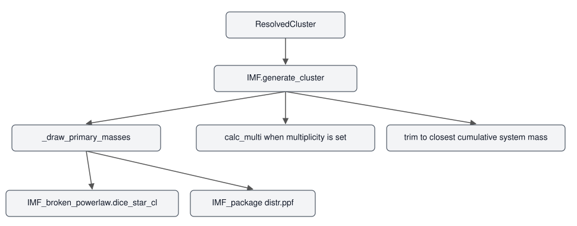

.. _imf_objects:

==========
IMF Object
==========

**Preferred for new work:**
:class:`~imf.imf.IMF_broken_powerlaw` with Kroupa (2001) slopes
(or the convenience class :class:`~imf.imf.Kroupa_2001`),
and pass
:class:`~imf.multiplicity.MultiplicityUnresolvedOffner2023`
(or :class:`~imf.multiplicity.MultiplicityResolvedOffner2023`
when orbits are needed). For Chabrier or other analytic forms from
the optional `initial_mass_function
<https://github.com/keflavich/imf>`_ package, use
:class:`~imf.imf.IMF_package` (see :ref:`imf_package`).

Initial Mass Functions (IMFs) are defined as classes in
``spisea/imf/imf.py``. These can be defined by::

  from spisea.imf import imf, multiplicity
  import numpy as np

  multi = multiplicity.MultiplicityUnresolvedOffner2023()
  mass_limits = np.array([0.08, 0.5, 1.0, 120.0])
  powers = np.array([-1.3, -2.3, -2.3])
  imf_obj = imf.IMF_broken_powerlaw(mass_limits, powers, multiplicity=multi)

SPISEA's own IMFs are power laws:
dn / dm ~ m^-alpha. The Broken Power-Law IMF object
gives users the flexibility to define the mass range
and exponents of the IMF. Other mass functions, such as
Chabrier (2003), are available through
:class:`~imf.imf.IMF_package` (see
:ref:`imf_package`).

The IMF object is an input for the :ref:`cluster_objects`, and will
be used to draw the inital stellar mass distribution for the cluster.
Omitting the multiplicity argument leaves all stars single. The
SPISEA v2.5 :class:`~imf.multiplicity.MultiplicityUnresolved` class
is still available.

Base IMF Class
--------------
.. autoclass:: imf.imf.IMF
	       :members: generate_cluster, calc_multi

Broken Power-Law IMFs
---------------------
.. autoclass:: imf.imf.IMF_broken_powerlaw
	       :show-inheritance:
		  
.. autoclass:: imf.imf.IMFSalpeter1955
	       :show-inheritance:
		  
.. autoclass:: imf.imf.Miller_Scalo_1979
	       :show-inheritance:
   
.. autoclass:: imf.imf.Kennicutt_1983
	       :show-inheritance:
		  
.. autoclass:: imf.imf.Kroupa_2001
	       :show-inheritance:
		  
.. autoclass:: imf.imf.Weidner_Kroupa_2004
	       :show-inheritance:

.. autoclass:: imf.imf.Salpeter_Kirkpatrick_2024
	       :show-inheritance:

.. _imf_package:

Mass Functions from initial_mass_function
-----------------------------------------
:class:`~imf.imf.IMF_package` draws primary masses from a mass
function in the `initial_mass_function
<https://github.com/keflavich/imf>`_ package
(`Richardson, Ginsburg & Koposov 2026
<https://doi.org/10.3847/1538-3881/ae8aef>`_). The package is
optional. Install it with::

  pip install initial_mass_function

or install SPISEA with the ``imf`` extra
(``pip install "SPISEA[imf]"``).

Pass a mass-function name (``'salpeter'``, ``'kroupa'``,
``'chabrier'``, ``'chabrierpowerlaw'``, or ``'chabrierlognormal'``),
a ``MassFunction`` class, or a ``MassFunction`` instance::

  from spisea.imf import imf, multiplicity

  multi = multiplicity.MultiplicityUnresolvedOffner2023()
  my_imf = imf.IMF_package('chabrier', mmin=0.03, mmax=120,
                           multiplicity=multi, seed=42)

The mass limits must be finite, with ``0 < mmin < mmax``. The
Chabrier mass functions default to ``[0, inf]``, so pass ``mmin``
and ``mmax`` explicitly for them. Masses are drawn with the IMF's
own random generator, so ``seed`` behaves as it does for the other
SPISEA IMFs. Multiplicity is still SPISEA's: the package mass
function is used for primaries, and the :ref:`multi_obj` adds
companions.

    Primary masses come from either the built-in broken power law or
    :class:`~imf.imf.IMF_package`; multiplicity and the cluster-mass
    trim stay in :meth:`~imf.imf.IMF.generate_cluster`.

Sampling time
^^^^^^^^^^^^^
For the same Kroupa (2001) IMF (slopes 0.3, 1.3, and 2.3 with breaks
at 0.08 and 0.5 Msun, on 0.03 – 120 Msun),
:class:`~imf.imf.IMF_package` draws a small cluster 2 – 5 times faster
than :class:`~imf.imf.IMF_broken_powerlaw`. Most of the gain is in the
primary-mass draw. Multiplicity costs the same in both, so the speedup
is smaller when companions are added.

.. list-table:: Median time to draw one cluster (ms)
   :header-rows: 1

   * - Cluster mass (Msun)
     - Multiplicity
     - ``IMF_broken_powerlaw``
     - ``IMF_package('kroupa')``
     - Speedup
   * - 1,000
     - none
     - 0.64
     - 0.12
     - 5.1×
   * - 1,000
     - ``MultiplicityUnresolvedOffner2023``
     - 0.83
     - 0.32
     - 2.6×
   * - 10,000
     - none
     - 3.67
     - 0.95
     - 3.9×
   * - 10,000
     - ``MultiplicityUnresolvedOffner2023``
     - 4.67
     - 2.20
     - 2.1×

Median of 30 calls to :meth:`~imf.imf.IMF.generate_cluster` after one
warmup call, on an Apple M5 Pro with Python 3.14, NumPy 2.4, and
initial_mass_function 2026.7.11 (November 2026). Repeated runs agree
to within about 20%. Reproduce the table with::

  pytest spisea/tests/test_imf.py::test_imf_package_timing -s

The first call to an :class:`~imf.imf.IMF_package` object also
computes the mean stellar mass, which takes up to about 20 ms for the
Chabrier mass functions (numerical integration). Later calls reuse it.

.. autoclass:: imf.imf.IMF_package
	       :show-inheritance: